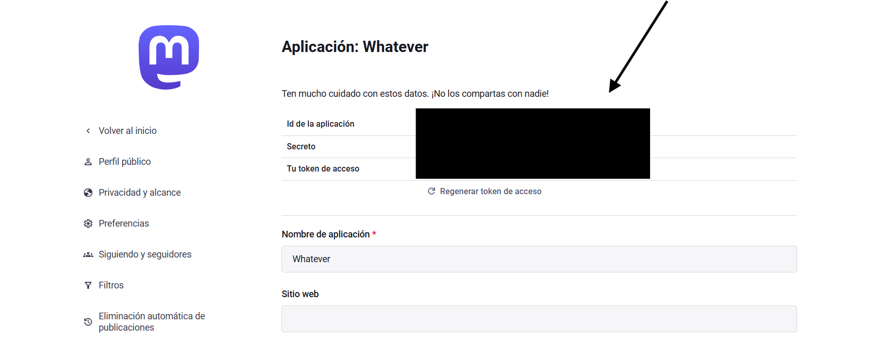

# 
# Reto de la API de Mastodon: Publicador de Estados

## 🎯 Objetivo

Construye una solución en **cualquier lenguaje de programación o framework** que publique correctamente un estado (toot) a través de la API de Mastodon. Es un reto abierto, pensado para poner a prueba tus habilidades de integración con APIs, tu creatividad y tus prácticas de desarrollo de software.

## 📋 Resumen del reto

**Objetivo principal:** crear una aplicación capaz de publicar al menos un estado en una instancia de Mastodon.

**Enfoque:** tienes total libertad para implementar la solución. Una herramienta CLI, una aplicación web, una app móvil o un servicio automatizado: ¡tú eliges!

---

## 🔑 Requisitos previos y configuración

Esta sección te guía paso a paso para configurar tus credenciales de la API de Mastodon.

### Paso 1: Elige una instancia de Mastodon

Mastodon es descentralizado. Puedes usar cualquier instancia en la que tengas cuenta, o crear una nueva:
- [mastodon.social](https://mastodon.social) (la instancia más grande)
- [mastodon.online](https://mastodon.online)
- [fosstodon.org](https://fosstodon.org) (centrada en tecnología)

### Paso 2: Crea una aplicación de desarrollo

Cuando tengas cuenta y hayas iniciado sesión:

1. **Ve a Preferencias**
   - Haz clic en el icono del engranaje o busca "Preferences" en el menú.

2. **Accede a los ajustes de desarrollo**
   - En la barra lateral, haz clic en **Development**.

3. **Crea una aplicación nueva**
   - Haz clic en el botón **New Application**.
   - **Application name**: por ejemplo, "Student API Challenge"
   - **Application website**: (opcional, puede ser tu repositorio de GitHub)
   - **Redirect URI**: déjalo como `urn:ietf:wg:oauth:2.0:oob`
   - **Scopes**: 
     - ✅ Asegúrate de que **`write:statuses`** está marcado (es necesario para publicar).
     - Para la mejora de subida de imágenes, marca también **`write:media`**.
     - Puedes dejar el resto de scopes por defecto como están.

4. **Guarda la aplicación**
   - Baja hasta el final y haz clic en **Submit**.

### Paso 3: Obtén tu access token

Ahora tienes que obtener tu access token. Así es el panel de la aplicación:



1. **Abre tu aplicación**
   - Haz clic en el nombre de la aplicación que acabas de crear ("Student API Challenge").

2. **Copia el access token**
   - Verás un campo llamado **Your access token**.
   - **CRÍTICO**: copia este token. Es la única credencial que necesitas para este reto.
   - Para publicar estados sencillos, Mastodon solo necesita este Bearer token: no hace falta ningún flujo OAuth ni claves adicionales.

### Paso 4: Guarda tus credenciales de forma segura

Crea un fichero `.env` en la raíz de tu proyecto:
```bash
MASTODON_ACCESS_TOKEN=your_access_token_here
MASTODON_INSTANCE_URL=https://mastodon.social  # Sustitúyela por tu instancia
```

**NO:**
- ❌ Las compartas con nadie
- ❌ Las publiques en foros públicos
- ❌ Las subas a Git

---

## ✅ Requisitos obligatorios

Tu solución **DEBE**:

1. **Autenticarse** en la API de Mastodon con tu access token.
2. **Publicar un estado** correctamente (mínimo 1 carácter y máximo 500 caracteres por defecto; el límite real de tu instancia es `configuration.statuses.max_characters` en `GET /api/v2/instance`).
3. **Gestionar los errores** con elegancia (tokens inválidos, rate limits, errores de red).
4. **Proteger los secretos**: usa variables de entorno o ficheros de configuración seguros.
5. **Incluir documentación**: un README con las instrucciones de instalación.

---

## 🚀 Mejoras opcionales

¡Te animamos a ampliar tu solución! Todas las sugerencias de abajo son compatibles con la API de Mastodon:

### Mejoras básicas

**Validación de la entrada y gestión de errores**
- Valida la longitud del estado antes de enviarlo (1-500 caracteres por defecto; lee el límite de la instancia en `GET /api/v2/instance` → `configuration.statuses.max_characters`).
- Comprueba que el estado no esté vacío ni tenga solo espacios en blanco.
- Gestiona con elegancia los errores de rate limit de la API de Mastodon (HTTP 429).
- Muestra mensajes de error útiles.

**Feedback al usuario y almacenamiento local**
- Pide confirmación antes de publicar.
- Muestra un mensaje de éxito con la hora y la URL del post creado.
- Guarda localmente los estados publicados (fichero JSON, CSV o en memoria).

**Modo de desarrollo**
- **Modo de prueba/mock**: permite publicar en un fichero local en lugar de en la API de Mastodon durante el desarrollo.
- **Opción dry-run**: muestra lo que se publicaría sin llamar de verdad a la API.

### Mejoras intermedias

**Construye tu propio wrapper de la API**
- **Basic Authentication**: protege los endpoints locales con los que publicas posts.
- **Autenticación con API key**: genera y valida API keys para tu servicio.
- **Tokens JWT**: usa JWT para gestionar las sesiones.

**Operaciones CRUD sobre borradores de estados**
- **Create**: guarda borradores de estados en local.
- **Read**: lista todos tus borradores guardados.
- **Update**: edita los borradores antes de publicarlos.
- **Delete**: elimina los borradores que no quieras.

**Funciones de entrada avanzadas**
- **Visibilidad**: permite elegir la visibilidad (`public`, `unlisted`, `private`, `direct`).
- **Content warning**: añade un texto de spoiler/aviso de contenido a tu post.
- **Sugerencias de hashtags**: añade automáticamente los hashtags configurados.

### Mejoras avanzadas

**Sistema de programación local**
- **Programa posts**: guarda posts con fechas futuras y una tarea en segundo plano que los publique.

**Interfaz web para tu servicio**
- **Frontend**: construye una interfaz para redactar y publicar estados.
- **Gestión de borradores**: una interfaz visual para gestionar los borradores.

**Generación de contenido e integración**
- **APIs públicas**: obtén datos de APIs gratuitas (tiempo, noticias, citas) y publica actualizaciones en Mastodon.

**Soporte de multimedia**
- **Subida de imágenes**: usa primero el endpoint `POST /api/v2/media` para subir una imagen (`/api/v1/media` está obsoleto desde Mastodon 3.1.3). El procesamiento es asíncrono: consulta `GET /api/v1/media/:id` hasta que devuelva una `url`, y después pasa el id en `media_ids[]` al crear el estado.

---

## 🔒 Requisitos de seguridad

**CRÍTICO: ¡nunca subas API keys ni secretos a tu repositorio!**

1. **Usa variables de entorno** (fichero .env).
2. **Añade `.env` a `.gitignore`**.
3. **Incluye un `.env.example`** como plantilla.

### Ejemplo: cargar variables de entorno en Python

El fragmento necesita `pip install requests python-dotenv`.

```python
import os
import uuid
from dotenv import load_dotenv
import requests

load_dotenv()

TOKEN = os.getenv('MASTODON_ACCESS_TOKEN')
INSTANCE = os.getenv('MASTODON_INSTANCE_URL')

def post_status(text, idempotency_key=None):
    url = f"{INSTANCE}/api/v1/statuses"
    headers = {
        "Authorization": f"Bearer {TOKEN}",
        "Content-Type": "application/json",
        # Opcional: si reintentas el MISMO post, pasa la MISMA key y Mastodon no lo publicará dos veces (las keys duran 1 hora)
        "Idempotency-Key": idempotency_key or str(uuid.uuid4())
    }
    data = {"status": text}
    
    response = requests.post(url, headers=headers, json=data, timeout=10)  # sin timeout, un problema de red puede dejarlo colgado para siempre
    response.raise_for_status()  # 401 (token incorrecto), 422 (estado inválido) y 429 (rate limit) se convierten en excepciones
    return response.json()
```

---

## 📝 Evaluación

El reto se califica sobre **10 puntos**:

| Criterio | Puntos | Nota máxima cuando... |
|---|---|---|
| **Publica un estado** (requisitos 1 y 2) | 3 | Se autentica con tu token, publica el estado y muestra la URL del post nuevo. |
| **Gestión de errores** (requisito 3) | 2 | Muestra un mensaje claro, nunca un traceback en bruto, ante un token inválido (`401`), un estado demasiado largo (`422`), un rate limit (`429`) y un error de red o timeout. |
| **Secretos** (requisito 4) | 2 | El token solo está en `.env`, `.env.example` solo tiene valores de ejemplo, `.env` está en `.gitignore` y nunca se ha subido ningún token (revisa también el historial de Git). |
| **README y código** (requisito 5) | 1.5 | Otra persona puede instalarlo y ejecutarlo siguiendo solo tu README; el código está organizado y es legible. |
| **Mejoras** | 1.5 | Al menos dos de las [mejoras opcionales](#-mejoras-opcionales), funcionando. |

**Para aprobar tienes que cumplir los requisitos 1, 2 y 4:** una solución que no puede publicar un estado, o que expone un token en cualquier parte del repositorio o de su historial, suspende independientemente del resto de puntos.

---

## 📦 Instrucciones de entrega

Incluye:
1. **Código fuente** (bien organizado).
2. **README.md** con los pasos de instalación y uso.
3. Plantilla **.env.example**.

Fecha límite y canal de entrega: se anunciarán en clase.

---

## 📚 Recursos útiles

- [Documentación de la API de Mastodon](https://docs.joinmastodon.org/api/)
- [Publicar un estado (documentación del endpoint)](https://docs.joinmastodon.org/methods/statuses/#create)
- [Scopes OAuth de Mastodon](https://docs.joinmastodon.org/api/oauth-scopes/)

---

*Última actualización: noviembre de 2026*
